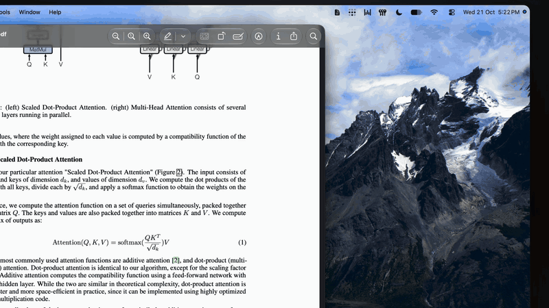

# PreviewChat

Ask questions about the PDF you have open in Preview, from the macOS menu bar.

You're reading, something doesn't click, you click the menu bar icon and ask. PreviewChat already has the document and knows which page you're on, so there's nothing to upload and no other app to switch to. Answers render Markdown and LaTeX math, and cite page numbers.

It runs on the [Claude Code](https://claude.com/claude-code) CLI you already have, so it uses your existing Claude plan. No API key, nothing else to sign up for. The app itself is about 10 MB and idles at around 30 MB of RAM.



## Install

You need macOS 26 or later on Apple Silicon, and the [`claude` CLI](https://docs.claude.com/en/docs/claude-code/setup) installed and logged in. If `claude` works in your terminal, you're set.

1. Download `PreviewChat-<version>.dmg` from [Releases](../../releases/latest).
2. Open it and drag **PreviewChat** to **Applications**.
3. The build isn't notarized yet, so macOS blocks the first launch. Open it once, then go to **System Settings → Privacy & Security** and click **Open Anyway**.
4. Allow the two permission prompts (see [Permissions](#permissions)).

To verify the download, put the `.sha256` file next to the DMG and run `shasum -a 256 -c PreviewChat-<version>.dmg.sha256`.

## Usage

Open a PDF in Preview, click the document icon in the menu bar, and type a question. The panel follows whichever PDF is frontmost, and each PDF keeps its own conversation until you quit.

| Key | Action |
| --- | --- |
| Return | Send |
| Shift+Return | New line |
| ⌘N | New chat for this PDF |
| ⌘, | Settings |

Pick the model (Haiku, Sonnet or Opus) from the menu in the panel header. The `…` menu switches the panel between portrait and landscape, and Settings changes the answer font and size.

## How it works

When you open a document, PreviewChat extracts its text with PDFKit, tagged by page. Your first question sends that text along with it. Every question also includes the page you're looking at, read from Preview's window title. For scanned pages, figures and tables, or very long documents (over ~600k characters), Claude opens the PDF itself with its Read tool.

Each question runs `claude -p` in the background with only the Read tool enabled, and with access to the folder your PDF is in. Follow-up questions resume the same Claude session, so it remembers the conversation.

## Permissions

- **Automation → Preview** lets PreviewChat ask Preview which PDF is open. Without it the panel shows "No PDF Open".
- **Accessibility** lets it read the page number from Preview's window title. Without it everything still works, but answers won't know which page you're on.

## Privacy

PreviewChat has no servers, accounts or analytics. Your questions and the PDF's text go to Anthropic through the `claude` CLI, under the same terms as the rest of your Claude usage, and they count toward your plan's usage limits.

Chats disappear from the app when you quit. The `claude` CLI still keeps its own session transcripts, under `~/.claude/projects/` in a folder ending in `Application-Support-PreviewChat`. Delete that folder to clear them.

## Troubleshooting

**"Couldn't launch claude" or "No such file or directory".** PreviewChat finds `claude` through your login shell (`zsh -il`), the same way Terminal does. Make sure `which claude` works in a new Terminal window. If you installed it through nvm or a similar tool, the PATH setup has to be in `~/.zshrc` or `~/.zprofile`.

**Login or auth errors.** Run `claude` in Terminal and log in. PreviewChat ignores `ANTHROPIC_API_KEY` on purpose, so it always uses your subscription and never bills an API key.

**"No PDF Open" while a PDF is open.** Allow PreviewChat under **System Settings → Privacy & Security → Automation → Preview**.

**Permissions reset after an update.** macOS ties permissions to the app's code signature. Builds signed ad hoc get a new identity each time, so you may need to allow them again.

## Build from source

```sh
./build.sh      # → build/PreviewChat.app
./release.sh    # → dist/PreviewChat-<version>.dmg (+ .sha256)
```

You need the Swift 6 toolchain. The Command Line Tools are enough, but a full Xcode is used if one is installed. `build.sh` signs with a Developer ID or Apple Development certificate if it finds one, and ad hoc otherwise.

<details>
<summary>Releasing</summary>

1. Bump `CFBundleShortVersionString` (semver) and `CFBundleVersion` (+1) in `Info.plist`.
2. Add an entry to `CHANGELOG.md` and commit.
3. Run `./release.sh` and smoke-test the DMG.
4. `git tag vX.Y.Z && git push --tags`
5. `gh release create vX.Y.Z dist/PreviewChat-X.Y.Z.dmg* --notes-file <notes>`

With a Developer ID certificate, `NOTARY_PROFILE=<profile> ./release.sh` also notarizes and staples the DMG, so Gatekeeper opens it without warnings.
</details>

## Contributing

Bug reports and pull requests are welcome. For anything bigger than a small fix, open an issue first so we can talk it through.

## License

[MIT](LICENSE). Bundled fonts are [Source Serif 4](https://github.com/adobe-fonts/source-serif) by Adobe, under the [SIL Open Font License](Resources/Fonts/LICENSE.md). Math rendering uses [SwiftMath](https://github.com/mgriebling/SwiftMath).
